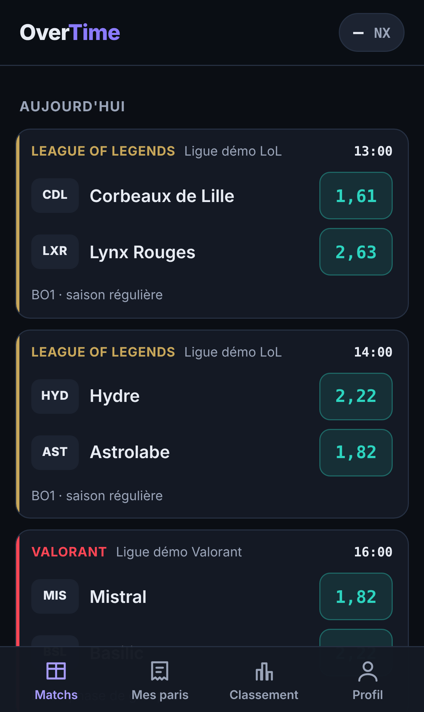

# OverTime

Application de pronostics e-sport entre amis, avec une monnaie virtuelle : le **noxus**.
Aucun argent réel n'entre ni ne sort à aucun moment : les noxus ne s'achètent pas,
ne se vendent pas et ne s'échangent contre rien.

<p align="center">
  
</p>

## État du projet

| Partie | État |
|---|---|
| Base de données (équipes, matchs, stats, paris, ligues, saisons) | ✅ prête et testée |
| Économie des noxus (paris, combinés, règlement, recharges, saisons) | ✅ prête et testée |
| Moteur de cotes (Elo, confrontations directes, séries, paris sur stats) | ✅ prototype Python, testé sur données simulées |
| Page des prochains matchs avec cotes | ✅ |
| Comptes et connexion | ⏳ à faire |
| Placer un pari depuis l'application | ⏳ à faire |
| Mes paris, classement, profil | ⏳ à faire |
| Saisie manuelle des matchs par l'admin | ⏳ à faire |
| Import automatique des données (Liquipedia / Leaguepedia) | ⏳ en attente d'accès |

## Organisation du dépôt

```
OverTime/
├── app/                  L'application (SvelteKit, JavaScript)
│   ├── src/routes/       Les pages : une page = un dossier
│   ├── src/lib/          Composants et fonctions partagés
│   │   └── server/       Code qui ne tourne QUE sur le serveur (accès à la base)
│   ├── static/           Icônes et manifeste (application installable)
│   └── .env.example      Modèle du fichier de configuration
├── db/                   La base de données PostgreSQL
│   ├── schema.sql        Les tables, commentées en français
│   ├── fonctions.sql     Tout ce qui touche aux noxus (paris, règlements...)
│   ├── tests_fonctions.sql  Tests automatiques de l'économie
│   ├── demo.sql          Données fictives pour essayer l'application
│   └── schema.png        Le plan de la base en image
├── outils/moteur_cotes/  Prototype Python du calcul des cotes
└── docs/                 Captures d'écran
```

---

## Installer et lancer OverTime sur Windows

Compte une demi-heure la première fois. Toutes les commandes se tapent dans
**PowerShell** (menu Démarrer → « PowerShell »).

### 1. Installer les outils

1. **Node.js** : sur [nodejs.org](https://nodejs.org), télécharge la version **LTS**
   et installe-la avec les options par défaut.
2. **PostgreSQL** : sur [postgresql.org/download/windows](https://www.postgresql.org/download/windows/),
   télécharge l'installateur et lance-le.
   - Il demande un **mot de passe pour l'utilisateur `postgres`** : note-le, c'est le
     compte administrateur de la base.
   - Garde le port **5432** proposé.
   - Coche bien « Command Line Tools » (pour avoir la commande `psql`).
3. **Git** : sur [git-scm.com](https://git-scm.com), installe Git avec les options par défaut.

Ferme puis rouvre PowerShell, et vérifie que tout répond :

```powershell
node --version
git --version
psql --version
```

> Si `psql` n'est pas reconnu, ajoute son dossier au PATH de Windows
> (`C:\Program Files\PostgreSQL\<version>\bin`) ou utilise le chemin complet.

### 2. Récupérer le projet

```powershell
cd $HOME\Documents
git clone https://github.com/hippolyte-vermandel/OverTime.git
cd OverTime
```

### 3. Créer la base de données

Choisis un mot de passe pour l'utilisateur `overtime` (différent de celui de `postgres`),
et remplace `MON_MOT_DE_PASSE` ci-dessous :

```powershell
# Indispensable sous Windows : sinon les accents des fichiers SQL sont mal lus
$env:PGCLIENTENCODING = "UTF8"

psql -U postgres -c "CREATE ROLE overtime LOGIN PASSWORD 'MON_MOT_DE_PASSE';"
psql -U postgres -c "CREATE DATABASE overtime OWNER overtime;"

psql -U overtime -d overtime -f db/schema.sql
psql -U overtime -d overtime -f db/fonctions.sql
psql -U overtime -d overtime -f db/demo.sql
```

`psql` demande à chaque fois le mot de passe de l'utilisateur indiqué après `-U`.

> `demo.sql` remplit la base avec des équipes **fictives** pour essayer l'application.
> Pour la vraie ligue, on créera une base propre sans ce fichier.

**Optionnel : vérifier que l'économie des noxus fonctionne.** Les tests tournent dans une
base séparée, pour ne pas mélanger leurs données avec les tiennes :

```powershell
psql -U postgres -c "CREATE DATABASE overtime_test OWNER overtime;"
psql -U overtime -d overtime_test -f db/schema.sql -f db/fonctions.sql -f db/tests_fonctions.sql
```

La dernière ligne affichée doit être `TOUS LES TESTS PASSENT`.

### 4. Configurer et lancer l'application

```powershell
cd app
Copy-Item .env.example .env
notepad .env
```

Dans le fichier qui s'ouvre, remplace `CHANGE_MOI` par le mot de passe de `overtime`, enregistre, ferme. Puis :

```powershell
npm install
npm run dev
```

Ouvre **http://localhost:5173** dans ton navigateur : les matchs de démonstration s'affichent.
Les modifications du code s'affichent en direct. `Ctrl + C` arrête le serveur.

### 5. Essayer sur ton téléphone (même Wi-Fi)

```powershell
npm run dev -- --host
```

Le terminal affiche une adresse du type `http://192.168.1.42:5173` : ouvre-la sur
l'iPhone. Si Windows demande d'autoriser Node.js dans le pare-feu, accepte pour les
**réseaux privés** uniquement.

> L'installation sur l'écran d'accueil (Safari → bouton Partager → « Sur l'écran
> d'accueil ») ne donnera une vraie application en plein écran qu'une fois le site servi
> en **HTTPS**, c'est-à-dire avec le tunnel qu'on mettra en place sur le PC serveur.

### 6. Version « production » (pour le PC serveur)

```powershell
npm run build
node --env-file=.env build
```

L'application tourne alors sur **http://localhost:3000**, sans le mode développement.

---

## Règles du jeu (réglables par ligue)

- **Solde de départ** : 1000 noxus au début de chaque saison.
- **Saisons** : un semestre (janvier-juin, juillet-décembre). À chaque nouvelle saison,
  tout le monde repart de 1000 noxus ; les classements passés restent consultables.
- **Recharge** : 150 noxus par semaine.
- **Mises** : de 10 à 500 noxus par pari.
- **Classement** : un seul classement par ligue, tous jeux confondus, au **rendement**
  (gains ÷ mises), pour ne pas avantager celui qui mise tout sur les favoris.
- **Paris** : fermés à l'heure de début du match.
- **Gains** : toujours arrondis à l'inférieur.
- **Combiné avec une sélection annulée** (joueur remplacé, map non jouée...) : on calcule le
  gain sans la sélection annulée et on en verse **la moitié** ; si cette moitié est
  inférieure à la mise, la mise est **remboursée en entier**. Si toutes les sélections
  sont annulées, la mise est remboursée.

## Sources des données

Pour l'instant, les matchs sont saisis à la main par l'administrateur de la ligue.
Sources envisagées : [Liquipedia](https://liquipedia.net) (accès API demandé),
[Leaguepedia](https://lol.fandom.com) pour League of Legends. Leurs contenus sont sous
licence CC-BY-SA et seront cités dans l'application.

OverTime n'est affilié à aucun éditeur de jeu ni organisateur de compétition.

## Licence

Code publié sous licence MIT (voir `LICENSE`).
